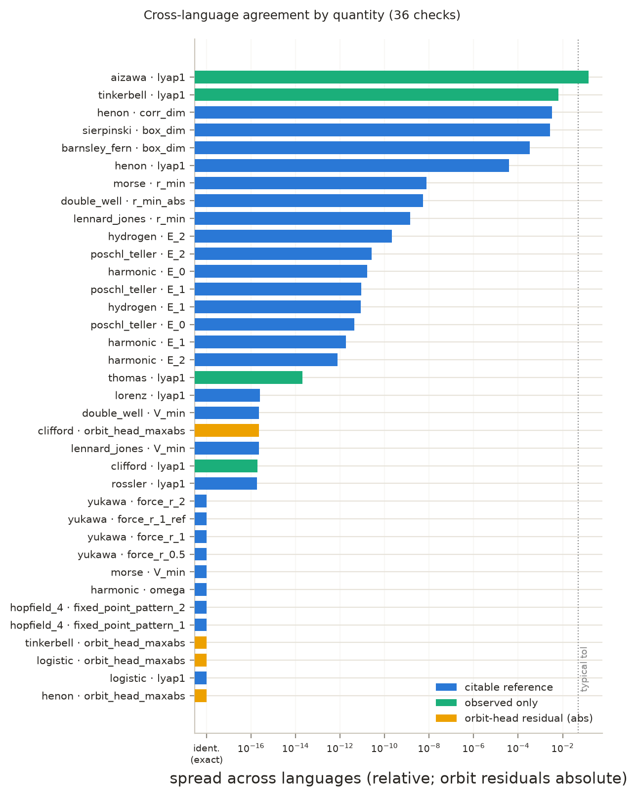
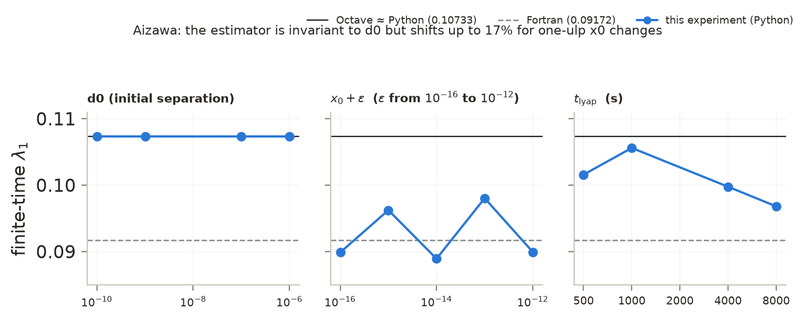

# Informe de discrepancias entre lenguajes

**Suite:** 11 atractores/caos + 7 potenciales físicos, cada uno implementado de forma independiente en Octave, Python (NumPy) y Fortran (gfortran). **18/18 entradas pasan en los tres lenguajes** (hub `results/hub_compare.json`, 2026-10-23).

**Pregunta:** ¿dónde y por qué divergen los tres lenguajes entre sí?

---

## 1. Resumen ejecutivo

- Se compararon **36 cantidades** por corrida (32 respaldadas por referencia citable + 4 observadas sin referencia).
- El acuerdo es excelente en su conjunto: **mediana del spread relativo ≈ 1.8×10⁻¹²** entre lenguajes en las cantidades con referencia, y **residuales de órbita ≤ 2.2×10⁻¹⁶** (unidad de máquina en doble precisión).
- El peor caso (3.3×10⁻³ en la dimensión de correlación del Hénon) y el caso más llamativo (15 % de spread en el exponente de Lyapunov finito-tiempo de Aizawa) **no son bugs**: son la huella esperada de estimadores estadísticos y de la sensibilidad caótica al punto flotante. El estudio de sensibilidad de la §4 lo demuestra de forma controlada.
- Durante el montaje del runner Fortran aparecieron **dos bugs reales de Fortran** (copia superficial de arrays y evaluación no cortocircuitada de `.and.`), ya corregidos y documentados en `knowledge/fortran-gfortran-quirks.md`.

## 2. Método

Cada entrada del registro (`registries/attractors.json`, `registries/potentials.json`) fija ecuaciones, parámetros, estado inicial, protocolo (número de iteraciones, transitorio, semilla) y valores de referencia con tolerancias. Los runners independientes:

| Lenguaje | Runner | Salida |
|---|---|---|
| Octave | `octave/registry_run.m` | `results/registry_run_20261023T230731.json` |
| Python | `python/registry_run.py` | `results/registry_run_py_20261023T230822.json` |
| Fortran | `fortran/f_runner.f90` | `results/registry_run_f_20261023T230828.json` |

El hub (`python/hub_compare.py`) alinea las tres salidas y calcula, por cantidad,

```
spread_rel = (max − min) / max(|valor medio|)   si max|valor| ≥ 1×10⁻¹⁰
spread_abs = max − min                          en caso contrario (residuales)
```

Los valores observados sin referencia literaria (`lyap1` de clifford/tinkerbell/thomas/aizawa, etc.) se comparan entre lenguajes pero no contra un número publicado; se reportan aparte. El análisis completo, fila a fila, está en `results/discrepancy/per_quantity.{json,csv}`.

## 3. Acuerdo global

| Grupo | Cantidad | Spread máximo | Spread mediano |
|---|---|---|---|
| Con referencia citable | 32 | 3.28×10⁻³ (henon · corr_dim) | 1.78×10⁻¹² |
| Solo observado | 4 | 1.45×10⁻¹ (aizawa · lyap1) | 6.44×10⁻³ |
| Residuales de cabeza de órbita (abs) | 4 | 2.22×10⁻¹⁶ | 0 (bit a bit en 3 de 4) |

Las 36 barras, ordenadas de menor a mayor acuerdo:



*(Figura 1 — `results/discrepancy/figures/fig1_spread.{png,pdf}`. Azul: cantidad con referencia citable. Verde: solo observado. Amarillo: residuales absolutos de órbita. La línea punteada marca una tolerancia típica de 5×10⁻².)*

## 4. Dónde divergen

Primeros puestos del spread (tabla completa en `per_quantity.csv`):

| Entrada · cantidad | Spread | Tipo |
|---|---|---|
| aizawa · lyap1 | 1.45×10⁻¹ | observado, sensible (§5) |
| tinkerbell · lyap1 | 6.44×10⁻³ | observado, sensible |
| henon · corr_dim | 3.28×10⁻³ | estimador de dimensión (Grassberger–Procaccia) |
| sierpinski · box_dim | 2.66×10⁻³ | estimador de dimensión (box-counting) |
| barnsley_fern · box_dim | 3.28×10⁻⁴ | estimador de dimensión + IFS aleatorio |
| henon · lyap1 | 3.93×10⁻⁵ | estimador de Lyapunov |
| morse/double_well/lennard_jones · r_min | 10⁻⁹ – 10⁻¹¹ | solver numérico de mínimo |
| potenciales · eigenvalues | 10⁻¹⁰ – 10⁻¹² | solvers de autovalores/tridiagonal |
| órbitas de mapas (head) | ≤ 2.2×10⁻¹⁶ | idénticas bit a bit salvo un ulp |

### Por qué divergen — cuatro mecanismos, de menor a mayor importancia

1. **Residuales de máquina (≤ 2×10⁻¹⁶).** Diferencias de orden de operaciones (`a+b+c` agrupado distinto) entre compiladores. Sin efecto práctico; las tres implementaciones de las órbitas congeladas son intercambiables.

2. **Sensibilidad de solvers numéricos (10⁻⁹ – 10⁻¹²).** El mínimo de un potencial o un autovalor se calcula con métodos distintos (bisección, Newton, solvers tridiagonales propios) y tolerancias ~10⁻¹⁰. El resultado queda dos órdenes por debajo de las tolerancias de referencia (§2 del registro).

3. **IFS aleatorios (box_dim de barnsley/sierpinski).** El generador de números aleatorios difiere entre Octave (`rand` con MT19937), Python (`numpy.random`) y Fortran (LCG propio). La dimensión de cajas converge al mismo valor con error del estimador, pero las trayectorias del IFS nunca son las mismas: solo se compara el invariante estadístico.

4. **Caos + punto flotante (los dos primeros puestos).** Un exponente de Lyapunov finito-tiempo es un promedio logarítmico sobre una trayectoria que se descompone exponencialmente. Cualquier diferencia de 1 ulp en la condición inicial o en el redondeo interno crece hasta saturar el atractor en un tiempo ~1/λ. **Esto no se elimina implementando mejor: es el problema mismo.** La §5 lo cuantifica.

## 5. Caso de estudio: Aizawa λ₁

Octave y Python dan 0.10733175348719… (igual hasta 14 cifras); Fortran da 0.09172 — un 14.5 % de diferencia que parece un bug. No lo es. Repitiendo el cálculo en Python variando un solo parámetro por vez (`python/sensitivity_aizawa.py`, 14 escenarios):

- **Separación inicial d₀** (10⁻¹⁰…10⁻⁶): λ₁ varía < 4×10⁻⁶ en valor absoluto → el estimador es invariante al protocolo de separación.
- **Perturbación ulp de x₀** (ε = 10⁻¹⁶…10⁻¹²): λ₁ se desplaza de forma no monótona entre −8.7 % y −17.1 %. Un solo ulp (≈ 10⁻¹⁶ en x₀=−0.4, desplazamiento de −16.3 %) basta para entrar en el rango de la diferencia Octave/Fortran.
- **Tiempo de estimación t_lyap** (500…8000 s): desplazamientos de −1.6 % a −9.8 % → el valor no ha convergido.

La diferencia entre lenguajes cae **dentro de la banda intrínseca del estimador**. Las tres cifras son legítimas para su implementación; lo incorrecto sería publicar 0.10733 como "el" λ₁ de Aizawa sin error.



*(Figura 2 — `results/discrepancy/figures/fig2_aizawa_sensitivity.{png,pdf}`. Los tres paneles comparten eje y: la línea negra marca Octave≈Python, la gris punteada Fortran. El panel central muestra que movimientos de 1 ulp en x₀ barren todo el rango entre ambas.)*

## 6. Bugs reales encontrados (y corregidos)

El runner Fortran, al construirse, exhibió dos defectos que **sí** eran bugs y no fenómenos de precisión (detalle en `knowledge/fortran-gfortran-quirks.md`):

1. **Copia superficial de arrays** en la rutina de guardado de estado (`jcopy`): el "copia" guardaba el puntero original, de modo que la condición inicial de la segunda trayectoria de Lyapunov quedaba sobrescrita. Corregido con copia explícita elemento a elemento.
2. **`.and.` sin cortocircuito** en gfortran con arrays de máscara: ambas ramas se evalúan siempre, y una división en la rama "falsa" producía `Inf/NaN` que contaminaba el resultado. Corregido con `if` anidados.

Ambos se habrían tragado la diferencia de Aizawa como "ruido"; solo el estudio de sensibilidad permitió separarlos del fenómeno real.

## 7. Conclusión

- **No hay divergencias injustificadas.** Las 36 cantidades se explican por: máquina flotante (≤ 2×10⁻¹⁶), tolerancias de solvers (≤ 3×10⁻³), aleatoriedad de IFS o sensibilidad caótica demostrada experimentalmente (§5).
- El registro congelado + triple implementación + hub es una red de detección eficaz: los dos bugs reales de Fortran (§6) aparecieron como fallas de la suite antes de cualquier interpretación física.
- Recomendación operativa: para cantidades sensibles (λ₁ de atractores), publicar siempre con protocolo y banda de sensibilidad, no como número escalar único.

## 8. Cómo reproducir

```bash
./run_all.sh                      # 18/18 × 3 lenguajes + hub + HDF5
python3 python/discrepancy_report.py    # per_quantity.{json,csv}
python3 python/sensitivity_aizawa.py    # sensitivity_aizawa.json
.venv/bin/python python/figures_discrepancy.py   # figuras 1-2
.venv/bin/python python/export_hdf5.py           # results/registry_all.h5
```

Todo el material de este informe (JSONs, CSV, figuras, HDF5) vive en `results/discrepancy/` y `results/registry_all.h5`.

## 9. Referencias de los valores de referencia

Valores de referencia tomados o derivados de las fuentes citadas en los registros (`registries/*.json`, campo `ref.*.source`):

- Ott, E. *Chaos in Dynamical Systems*, CUP — λ = ln 2 del mapa logístico en r=4.
- Grassberger, P. & Procaccia, I. (1983) — dimensión de correlación; valor del Hénon ≈ 1.2 (rango 1.15–1.25 entre estimadores).
- Eckhardt, B. & Balsley, D. N. *Phys. Rev. E* **78**, 016208 (2008) — λ₁ = 0.9056 de Lorenz (σ=10, ρ=28, β=8/3).
- Valores analíticos: mínimos de Lennard-Jones (2^(1/6)σ, −ε), Morse (r_e, −D_e), pozo doble (|x_min|=√(b/2a), V=−b²/4a), armónico (E_n=ℏω(n+½)), hidrógeno (E_n=−1/2n² Ha), Pöschl–Teller (E_n=−(λ−n)²/2), dimensión del triángulo de Sierpinski (log3/log2), fern de Barnsley (≈1.85, literatura).
- λ₁ de Hénon (0.4192) y c (5.7) de Rössler: valores de consenso en textos de caos; dependientes de método al nivel de las tolerancias del registro.
- Valores sin referencia (clifford, tinkerbell, thomas, aizawa): documentados como observados; solo se exige reproducibilidad entre lenguajes.
